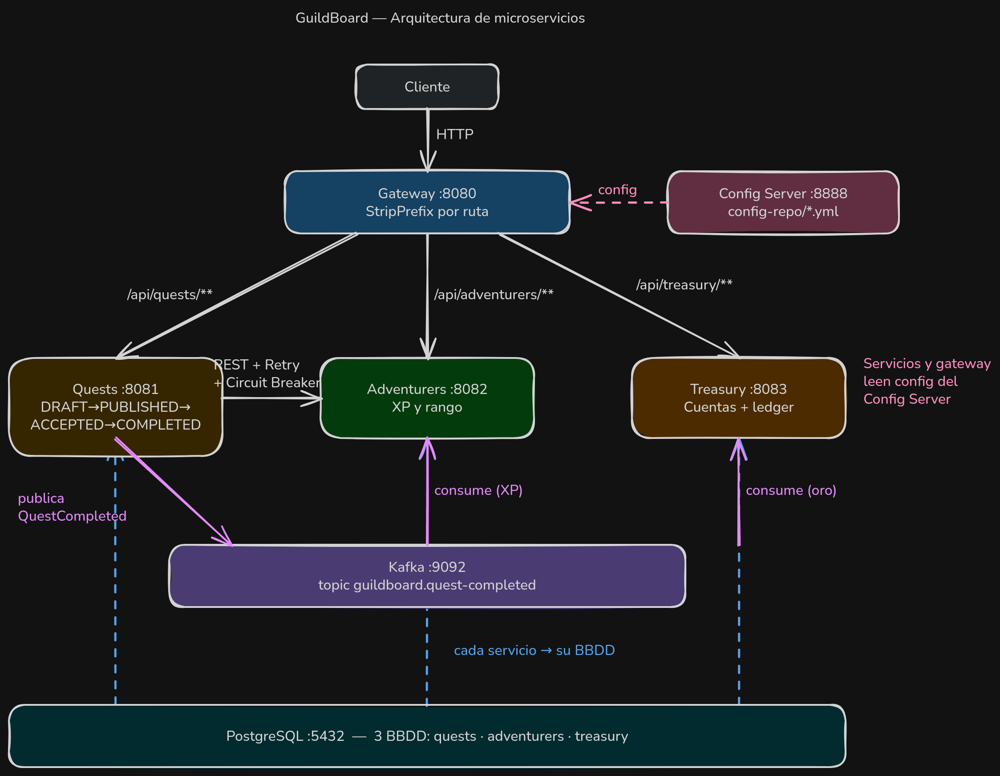

# 🏰 GuildBoard — Arquitectura Hexagonal → Microservicios

> Proyecto de aprendizaje: un tablón de misiones de gremio que evoluciona capítulo a capítulo, desde un monolito hexagonal hasta un sistema de microservicios con eventos, resiliencia, configuración centralizada y API Gateway.

    

---

## 🎯 Propósito

Practicar **arquitectura hexagonal (puertos y adaptadores)** y llevarla a un entorno **distribuido**. El dominio es simple a propósito (aventureros, misiones y oro) para que el foco esté en la arquitectura:

- Dominio puro, sin Spring ni JPA.
- Un servicio = 4 módulos Gradle con dependencias que solo apuntan hacia dentro.
- Comunicación **síncrona** (REST + circuit breaker) y **asíncrona** (Kafka).
- Reglas de arquitectura **verificadas por tests** (ArchUnit).

El PDF de referencia está en [`docs/hexagonal-architecture.pdf`](docs/hexagonal-architecture.pdf).

---

## 🗺️ Vista general



| Componente | Puerto | Responsabilidad |
|---|---|---|
| **gateway** | 8080 | Punto de entrada único; enruta por prefijo a cada servicio |
| **quests** | 8081 | Ciclo de vida de las misiones (publicar → aceptar → completar) |
| **adventurers** | 8082 | Registro de aventureros, experiencia y rango |
| **treasury** | 8083 | Cuentas de oro y libro contable (*ledger*) |
| **config-server** | 8888 | Configuración centralizada desde `config-repo/` |
| **token-issuer** | 9000 | Emisor de JWT (RS256) de desarrollo; publica sus claves en `/.well-known/jwks.json` |
| **zipkin** | 9411 | Visor de trazas distribuidas (desde el capítulo 15, solo en Docker) |
| **kafka** | 9092 | Bus de eventos |
| **postgres** | 5432 | Una base de datos por servicio |

---

## 🚀 Puesta en marcha paso a paso

**Requisitos:** JDK 21, Docker + Docker Compose, `curl` y `jq` (para los scripts).

Todos los comandos desde `guildboard/`:

```bash
cd guildboard
```

### 1️⃣ Infraestructura (Kafka + Postgres)

```bash
docker compose up -d
docker compose ps        # espera a que ambos estén "healthy"
```

`infra/postgres/init.sql` crea las bases `quests`, `adventurers` y `treasury` en el primer arranque.

### 2️⃣ Config Server (siempre primero)

```bash
./gradlew :config-server:bootRun
```

Los demás servicios importan su configuración de `http://localhost:8888` (`optional:`, así que arrancan igualmente sin él, pero perderían puertos, Kafka y topic). Comprueba que sirve configuración:

```bash
curl localhost:8888/quests/default
```

### 3️⃣ Los servicios (una terminal cada uno)

```bash
./gradlew :adventurers-bootstrap:bootRun
./gradlew :quests-bootstrap:bootRun
./gradlew :treasury-bootstrap:bootRun
./gradlew :gateway:bootRun
```

> 💾 **Persistencia:** por defecto cada servicio usa repositorios **en memoria**. Para usar Postgres (con migraciones Flyway) añade el perfil:
> ```bash
> ./gradlew :quests-bootstrap:bootRun --args='--spring.profiles.active=postgres'
> ```

### 4️⃣ Token issuer (desde el capítulo 14)

Los servicios son ahora *resource servers* JWT y validan los tokens contra el JWKS de `:9000`. Arranca el emisor (junto al resto, tras el Config Server):

```bash
./gradlew :token-issuer:bootRun
```

Usuarios de desarrollo (en `tools/token-issuer/src/main/resources/application.yml`): `master/master` (rol `GUILD_MASTER`) y `hero/hero` (rol `ADVENTURER`, con `subject` = id de la aventurera). Obtener un token:

```bash
curl -s -X POST localhost:9000/token -H 'Content-Type: application/json' \
  -d '{"username":"master","password":"master"}'
# → {"access_token":"…","token_type":"Bearer","expires_in":900}
```

### 🐳 Alternativa (capítulo 15): todo en Docker Compose

En vez de los pasos 2–4, se pueden levantar todos los servicios como contenedores. Primero se construyen los JAR (los `Dockerfile` copian `build/libs/app.jar`):

```bash
./gradlew bootJar
docker compose up -d --build --wait
```

Los servicios arrancan con los perfiles `docker,postgres` y piden su configuración a `config-server`. Las trazas se ven en `http://localhost:9411` (Zipkin) y las métricas en `localhost:8081/actuator/metrics` (con token). `scripts/tok.sh master` imprime un token y `scripts/c15-script.sh` ejercita el flujo de observabilidad.

### 5️⃣ Probar el flujo completo

> ⚠️ Desde el capítulo 14 todas las peticiones necesitan `Authorization: Bearer <token>`; los `curl` de abajo son el flujo sin autenticar y devolverán `401` hasta que añadas la cabecera.

O a mano, todo por `localhost:8080`:

```bash
# 1. Crear aventurera
curl -s -X POST localhost:8080/api/adventurers \
  -H 'Content-Type: application/json' -d '{"name":"Lucía"}'
# → {"id":"…","name":"Lucía","rank":"NOVICE","experience":0}

# 2. Publicar misión
curl -s -X POST localhost:8080/api/quests \
  -H 'Content-Type: application/json' \
  -d '{"title":"Limpiar la casa","reward":150,"requiredRank":"NOVICE"}'

# 3. Aceptarla  (usa los ids devueltos; con JWT el aventurero sale del token y el cuerpo es opcional)
curl -s -X POST localhost:8080/api/quests/$QUEST/accept \
  -H 'Content-Type: application/json' -d '{"adventurerId":"'$LUCIA'"}'

# 4. Completarla → dispara el evento en Kafka
curl -s -X POST localhost:8080/api/quests/$QUEST/complete

# 5. Efectos asíncronos: XP/rango y oro
curl -s localhost:8080/api/adventurers/$LUCIA     # experience: 150, rank: ADEPT
curl -s localhost:8080/api/treasury/accounts/$LUCIA   # balance: 150
```

---

## 🧩 Los servicios en detalle

### 📜 Quests — `:8081`

Dueño del ciclo de vida de la misión: `DRAFT → PUBLISHED → ACCEPTED → COMPLETED`.

| Método | Ruta (vía gateway) | Body | Descripción |
|---|---|---|---|
| `POST` | `/api/quests` | `{title, reward, requiredRank, validForMinutes?}` | Crea y publica una misión (`201`) |
| `GET` | `/api/quests/{id}` | — | Consulta una misión (`404` si no existe) |
| `POST` | `/api/quests/{id}/accept` | `{adventurerId}` | Un aventurero acepta la misión |
| `POST` | `/api/quests/{id}/complete` | — | Completa la misión y **publica evento** |

**Reglas de dominio** (errores como `ProblemDetail`):

| Regla | HTTP |
|---|---|
| Misión o aventurero inexistente | `404` |
| Transición de estado inválida | `409` |
| Rango insuficiente (`NOVICE < ADEPT < VETERAN`) | `422` |
| Máx. **3** misiones activas por aventurero | `422` |
| Misión no publicada / caducada | `422` |
| `adventurers` caído o circuito abierto | `503` |

**Colaboraciones:**
- 🔌 *Sale* → `GET adventurers/{id}` (REST, timeouts de 1 s, **Retry** ×3 con backoff exponencial + **Circuit Breaker** con Resilience4j).
- 📣 *Sale* → evento `QuestCompleted` al topic `guildboard.quest-completed`.
- 🔔 *Sale* → notificación (adaptador de log).

### 🧙 Adventurers — `:8082`

| Método | Ruta (vía gateway) | Body | Descripción |
|---|---|---|---|
| `POST` | `/api/adventurers` | `{name}` (≤ 50) | Registra un aventurero (`NOVICE`, 0 XP) |
| `GET` | `/api/adventurers/{id}` | — | `{id, name, rank, experience}` |

- 📥 *Escucha* `QuestCompleted` → suma XP igual a la recompensa. Los rangos suben con la experiencia: **ADEPT ≥ 100**, **VETERAN ≥ 300** (nunca bajan).
- ☠️ Mensajes que fallan van a la *dead-letter topic* `guildboard.quest-completed-adventurers-dlt`.

### 💰 Treasury — `:8083`

| Método | Ruta (vía gateway) | Descripción |
|---|---|---|
| `GET` | `/api/treasury/accounts/{adventurerId}` | Saldo de la cuenta `{adventurerId, balance}` |
| `GET` | `/api/treasury/accounts/{adventurerId}/ledger-balance` | Saldo **recalculado** sumando el libro contable |

- 📥 *Escucha* `QuestCompleted` → registra una entrada en el *ledger* y acredita la cuenta.
- 🔁 **Idempotente**: pagar dos veces la misma misión se ignora (existe check en servicio + índice único `V2__unique_quest_payment.sql`).
- ☠️ DLT propia: `guildboard.quest-completed-treasury-dlt`.

### 🚪 Gateway — `:8080`

| Ruta externa | Destino | Transformación |
|---|---|---|
| `/api/quests/**` | `:8081` | `StripPrefix=1` → `/quests/**` |
| `/api/adventurers/**` | `:8082` | `StripPrefix=1` → `/adventurers/**` |
| `/api/treasury/**` | `:8083` | `StripPrefix=2` → `/**` (ej. `/accounts/…`) |

### 🔐 Token Issuer — `:9000`

Módulo `tools/token-issuer` (no es un servicio hexagonal). Genera un par RSA en memoria al arrancar.

| Método | Ruta | Descripción |
|---|---|---|
| `POST` | `/token` | `{username, password}` → JWT RS256 con `sub`, `iss`, `exp` y claim `roles`; `401` si las credenciales no coinciden |
| `GET` | `/.well-known/jwks.json` | Clave pública (JWKS) para que los servicios validen la firma |

**Autorización en los servicios** (`SecurityConfig` en el adaptador web de cada uno, importado desde `bootstrap`; el claim `roles` se convierte a `ROLE_*`):

| Servicio | Regla |
|---|---|
| **quests** | `POST /quests` → `GUILD_MASTER`; `POST /quests/*/accept` → `ADVENTURER`; `POST /quests/*/complete` → cualquiera de los dos; el resto, autenticado |
| **adventurers** | `POST /adventurers` → `GUILD_MASTER`; el resto, autenticado |
| **treasury** | Todo autenticado |

### ⚙️ Config Server — `:8888`

Perfil `native`: sirve los ficheros de `config-repo/` (`application.yml` común + uno por servicio).

---

## 🧱 Estructura de cada servicio

Cada servicio son **4 módulos Gradle**, y el compilador impide romper la regla de dependencias:

```
services/<servicio>/
├── domain/        ← lógica pura de negocio (sin frameworks)
├── application/   ← casos de uso + puertos (in / out)
├── adapters/      ← web, JPA, memoria, Kafka, REST client
└── bootstrap/     ← Spring Boot, @Configuration, migraciones, ArchUnit
        dependencias:  bootstrap → adapters → application → domain
```

Tests de arquitectura: `ArchitectureTest` (ArchUnit) por servicio y `StructureTest` en la raíz, que exige los 4 módulos por servicio.

```bash
./gradlew test
```

---

## 🆕 Cambios nuevos y aprendizajes — Capítulo 15

**Tema:** Contenedores y observabilidad. Hasta el capítulo 14 los servicios se lanzaban con `bootRun` a mano; ahora todo el sistema se levanta con `docker compose` y cada petición se puede seguir con trazas (Zipkin) y métricas (Actuator).

### ✅ Qué se desarrolló

- 🐳 **Un `Dockerfile` por aplicación** (config-server, token-issuer, gateway, quests, adventurers, treasury): imagen `eclipse-temurin:21-jre`, usuario de sistema sin privilegios y `COPY build/libs/app.jar`. Cada `build.gradle` fija `archiveFileName = 'app.jar'` en `bootJar`.
- 🧩 **`compose.yaml` completo**: además de Kafka y Postgres, define `zipkin`, `config-server`, `token-issuer`, `adventurers`, `treasury`, `quests` y `gateway`, con `healthcheck` y `depends_on: condition: service_healthy` para que arranquen en orden.
- 🌐 **Perfil `docker`** (`config-repo/application-docker.yml`): Kafka en `kafka:19092`, JWKS en `token-issuer:9000`, rutas del gateway a los nombres de servicio (`quests:8081`…), `guildboard.db.host=postgres` y `guildboard.adventurers.base-url` apuntando al contenedor. Los servicios arrancan con `SPRING_PROFILES_ACTIVE=docker,postgres` y `SPRING_CONFIG_IMPORT=configserver:http://config-server:8888`.
- 🗄️ `application-postgres.yml` de cada servicio usa `${guildboard.db.host:localhost}`: el mismo binario vale en local y en contenedor.
- 🩺 **Actuator** en gateway, quests, adventurers y treasury; `config-repo/application.yml` expone `health,metrics`. Los `SecurityConfig` dejan pasar `/actuator/health/**` sin token (para los *healthchecks*).
- 🔭 **Trazas distribuidas**: `spring-boot-starter-zipkin`, muestreo al 100 % (`management.tracing.sampling.probability: 1.0`), observación activada en el `KafkaTemplate` y en el listener, y endpoint a `http://zipkin:9411` en Docker.
- 🔗 Quests construye su `RestClient` a partir del `RestClient.Builder` de Spring (`AdventurerClientFactory`, `RestAdventurerDirectory`, `BeanConfig`) para que la llamada a Adventurers propague el contexto de traza; se añade `spring-boot-starter-restclient`.
- 🧪 `scripts/c15-script.sh` (crea misiones, consulta una y revisa `/actuator/metrics/http.server.requests` con filtros por `uri`) y `scripts/tok.sh <usuario>` (imprime un token).

### 🧠 Qué se aprendió

| Aprendizaje | Detalle |
|---|---|
| **`localhost` ya no es el mismo sitio** | Dentro de un contenedor, `localhost` es el propio contenedor: hay que usar el nombre del servicio de Compose (`postgres`, `kafka`, `config-server`…) y, para Kafka, un listener interno (`kafka:19092`) distinto del publicado al host (`localhost:9092`) |
| **Perfiles para cambiar de entorno** | El perfil `docker` sobrescribe solo lo que cambia (hosts y URLs); el binario y el resto de la configuración son los mismos |
| **Healthcheck + `depends_on`** | Que un contenedor esté arrancado no significa que esté listo; `service_healthy` ordena el arranque (config-server → servicios → gateway) |
| **El *healthcheck* no puede exigir token** | `/actuator/health/**` se permite sin autenticar; el resto de actuator sigue protegido |
| **Trazas = una petición, varios servicios** | Un `traceId` recorre gateway → quests → adventurers (y los mensajes Kafka); Zipkin lo dibuja como un árbol de *spans* |
| **Traza y métricas responden a preguntas distintas** | La traza explica *qué pasó en esta petición*; las métricas (`http.server.requests`, filtradas por `uri`) explican *cómo se comporta el servicio en conjunto* |
| **Usar el *builder* de Spring** | Un `RestClient` creado con `RestClient.builder()` a mano no lleva la instrumentación; el inyectado sí |
| **Imágenes ligeras y seguras** | JRE en vez de JDK, usuario sin privilegios, y el JAR se construye fuera (`./gradlew bootJar`) y se copia |

---

## 📈 Evolución del aprendizaje

| Cap. | Hito | Aprendizaje clave |
|:---:|---|---|
| **1** | Primer endpoint: caso de uso + adaptador web + repositorio en memoria | Un caso de uso no sabe nada de HTTP |
| **3** | DTOs, mapeadores, errores HTTP, `Clock`, `NotificationSender` | Mapear en el borde; inyectar el tiempo para poder testear |
| **5** | Invariantes de dominio con agregados | El agregado protege sus reglas; estados inválidos imposibles |
| **6** | Mappers y DTOs separados | Dominio ≠ modelo web ≠ modelo de persistencia |
| **7** | Multi-módulo Gradle | Que el **compilador** haga cumplir la arquitectura |
| **8** | Cortes para microservicios (Quests / Adventurers) | Dónde está la frontera de un servicio |
| **10** | Servicios separados, REST + Resilience4j, Postgres + Flyway | Retry, circuit breaker, timeouts y migraciones versionadas |
| **11** | Eventos con Kafka (Treasury, XP) | Consistencia eventual; DLT; consumidores independientes |
| **12** | Config Server | Una sola fuente de configuración para todos |
| **13** | API Gateway | Una única puerta de entrada; `StripPrefix` |
| **14** | Seguridad con JWT (token-issuer + resource servers) | 401 vs 403; la identidad sale del token, no del cuerpo |
| **15** | Docker Compose para todo el sistema + Actuator y Zipkin | `localhost` ≠ nombre de servicio; healthchecks ordenan el arranque; trazas y métricas responden a preguntas distintas |

### 🎓 Aprendizajes generales hasta ahora

1. **La arquitectura se puede testear.** ArchUnit y los módulos Gradle convierten las reglas en errores de compilación o de test, no en acuerdos verbales.
2. **El dominio manda.** `Quest` y `Adventurer` no conocen Spring ni JPA. Los errores son un `sealed interface DomainError` con `switch` exhaustivo, traducido a HTTP solo en el adaptador.
3. **Los puertos permiten cambiar la tecnología.** Memoria ↔ Postgres con un perfil, REST ↔ Kafka tras interfaces, sin tocar la lógica.
4. **Una llamada de red falla.** Timeouts, reintentos con backoff y circuit breaker son parte del diseño, y se traducen en un `503` limpio para el cliente.
5. **Los eventos exigen idempotencia y DLT.** Entrega "al menos una vez" implica duplicados; hay que diseñar para ellos.
6. **Cada servicio, su base de datos.** Nada de joins entre servicios: se pide por REST o se reacciona a eventos.
7. **Configuración externalizada.** El mismo binario, distinto entorno.
8. **Una puerta de entrada simplifica al cliente** y oculta la topología.
9. **Nunca confíes en la identidad que manda el cliente.** Se deriva del token firmado y se valida en cada servicio, no solo en el gateway.
10. **Lo que no se observa no se puede operar.** Healthchecks, métricas y trazas distribuidas son parte del sistema, no un añadido; y un entorno (local vs Docker) se cambia con perfiles, no con otro código.

### 🔭 Siguientes pasos posibles

- Registro/descubrimiento de servicios en vez de URLs fijas.
- Outbox pattern (hoy el guardado y la publicación del evento no son atómicos).
- Validación del JWT también en el gateway y *rate limiting*.
- Un proveedor de identidad real (Keycloak / Spring Authorization Server) en vez del token-issuer con claves en memoria y usuarios fijos.
- Exportar las métricas a Prometheus + Grafana (hoy solo se consultan por `/actuator/metrics`) y centralizar logs.
- Bajar el muestreo de trazas del 100 % y proteger/limitar los endpoints de actuator.
- Construir los JAR dentro de la imagen (*multi-stage build*) en vez de requerir `./gradlew bootJar` antes.
- Tests de integración con Testcontainers.
